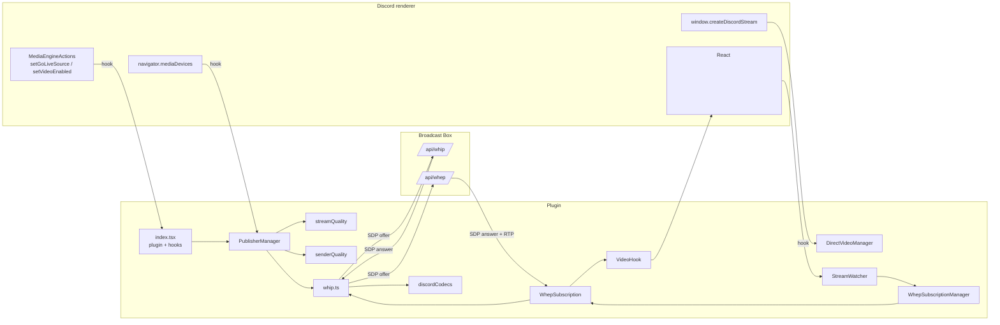

# Architecture

## 1. Problem statement

Discord's Go Live uses Discord's SFU and its own media engine. The goal of this
plugin is to:

1. Capture the exact screen/camera track Discord produces.
2. Publish it to a self-hosted Broadcast Box instance over WHIP.
3. Make every call participant play the Broadcast Box WHEP feed instead of the
   Discord-provided stream.
4. Leave Discord's own audio, voice state and call UI untouched.

The plugin is a **client-side relay**. Broadcast Box is the only media server in
the path; Discord is still used for signalling, chat, voice and presence.

## 2. Component map

## 3. Layers and responsibilities

| Layer | Module(s) | Responsibility |
| --- | --- | --- |
| Discord integration | `index.tsx` | Patch Discord functions, translate Discord state into plugin state. |
| Publishing lifecycle | `PublisherManager` (in `index.tsx`) | One active WHIP session per `StreamKind`; abort/replace/stop rules. |
| Track acquisition | `DirectVideoManager` + hooks | Obtain the native capture track, cache it, release it. |
| Quality translation | `streamQuality.ts` | Convert Discord's Go Live config into `StreamQuality`. |
| Encoding control | `senderQuality.ts` | Apply resolution/frame-rate to the RTP sender without touching Discord's capture. |
| Codec policy | `discordCodecs.ts` | Order/choose codecs the way Discord's native stream encoder does. |
| Protocol | `whip.ts` | WHIP publish and WHEP subscribe primitives. |
| Subscription lifecycle | `WhepSubscription.ts` | Persistent, reconnecting WHEP connection per remote stream. |
| Subscription registry | `WhepSubscriptionManager.ts` | Shared subscription instances keyed by `<userId>-<kind>`. |
| DOM discovery | `StreamWatcher.ts` | Find tiles, resolve user/kind, attach/detach `VideoHook`s. |
| DOM binding | `VideoHook.ts` | Lock `srcObject`, autoplay, hide Discord placeholders. |
| Platform policy | `native.ts` | CSP allow-list for the Broadcast Box host. |

Each module has one reason to change. In particular:

- `whip.ts` knows the protocol but nothing about Discord.
- `WhepSubscription.ts` knows connection lifecycle but nothing about DOM.
- `VideoHook.ts` knows DOM binding but nothing about WebRTC.
- `PublisherManager` knows session arbitration but nothing about SDP.
- `discordCodecs.ts` and `streamQuality.ts` are pure policy modules with no I/O.

## 4. State ownership

| State | Owner | Lifetime |
| --- | --- | --- |
| Active/pending WHIP sessions | `PublisherManager` | One per `scrn`/`cam`, replaced on new stream. |
| Current native track IDs | `PublisherManager` | Session lifetime. |
| Discord stream IDs for own share/camera | `index.tsx` module scope | Screen/camera session. |
| Requested Go Live quality | `index.tsx` module scope (`requestedScreenQuality`) | Screen session. |
| Direct-video stream cache | `DirectVideoManager` | Until released. |
| WHEP subscriptions | `WhepSubscriptionManager` | Until closed or orphan grace expires. |
| Attached video elements | `WhepSubscription` | Until element detaches. |
| Hidden placeholder elements | `VideoHook` | Until hook destroyed. |

The renderer is single-threaded. All async work is `Promise`-based and guarded by
generation counters (`WhepSubscription.connectionGen`) or abort controllers
(`PublisherManager`).

## 5. Why video-only?

The plugin deliberately never adds an audio track:

- Discord keeps owning voice transport, mute, deafen, per-user volume and audio
  devices.
- Broadcast Box ingest stays simple: one video RTP stream, no audio sync
  problems, no double audio.
- The stream is meant to be a visual replacement, not a second voice channel.

This is enforced in `whip.ts` (`addTransceiver(track, { direction: "sendonly" })`
with a video track only) and in `subscribe` (one receive-only video transceiver).

## 6. Why tap Discord's track instead of re-capturing?

Discord exposes the capture through several partially documented paths:

1. `MediaEngineActions.setGoLiveSource` gives the plugin the source config.
2. `window.createDiscordStream(streamId)` returns a native `MediaStream` for
   streams known to the client.
3. `navigator.mediaDevices.getDisplayMedia` / `getUserMedia` are the public
   browser fallbacks.

The plugin prefers the native track because it is exactly what Discord would
have sent: same source, same crop, same capture constraints. Re-capturing would
open a second capture, may show the wrong monitor, and could be blocked by the
OS. `getDisplayMedia` is only the fallback for Vesktop builds where the native
track is not reachable.

## 7. Why a persistent WHEP subscription?

Discord re-renders tiles aggressively (layout changes, popouts, PiP, theater
mode). Tying the WHEP connection to a `<video>` element would tear down and
re-create the WebRTC connection on every render. Instead:

- `WhepSubscriptionManager` keeps one subscription per `<userId>-<kind>`.
- `WhepSubscription` survives element detach for a 25 s orphan grace period.
- `VideoHook` can attach/detach any number of elements to the same stream.
- On ICE/network failure the subscription reconnects after 3 s, as long as it is
  still desired.

## 8. Failure containment

- Publisher failures are caught per session and never break Discord's own call.
- WHEP failures retry with a new connection generation; stale callbacks are
  ignored through `isStale(gen)`.
- Codec capability probing has a 500 ms timeout and falls back to a static
  priority list.
- Sender parameter updates are best-effort; a rejected update only logs a
  warning.
- DOM operations are guarded (`try/catch`) so a Discord markup change degrades
  the replacement, not the whole client.

## 9. SOLID mapping

| Principle | Example |
| --- | --- |
| Single Responsibility | `whip.ts` protocol vs `VideoHook.ts` DOM vs `WhepSubscription.ts` lifecycle. |
| Open/Closed | Adding a new `StreamKind` only requires extending the union and key mapping. |
| Liskov | `WhepSubscription` exposes a small lifecycle contract (`start/attach/close/isAlive`). |
| Interface Segregation | `WhipSession` exposes only `id`, `pc`, `resourceUrl`, `close`. |
| Dependency Inversion | `PublisherManager` depends on the `publish` abstraction, not on Broadcast Box details. |

## 10. Known constraints

- Broadcast Box must be reachable from every participant's network; the plugin
  does not implement a TURN fallback (only public STUN servers are configured).
- The plugin assumes the Broadcast Box stream key equals `<DiscordUserId>-<kind>`.
- The viewer UI interception depends on Discord's DOM and React internals; this
  is the fragile part documented in [plugin-flow.md](./plugin-flow.md).
- `native.ts` hard-codes the CSP host. Changing `baseUrl` requires changing
  `BROADCAST_BOX_HOST` and restarting the client.