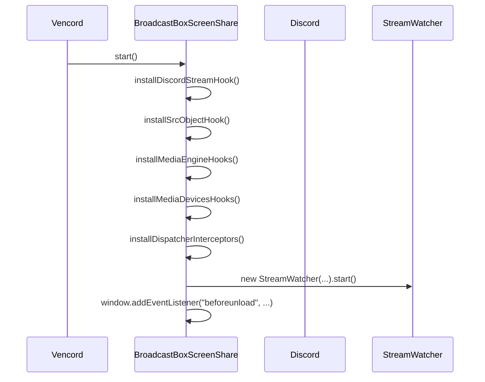
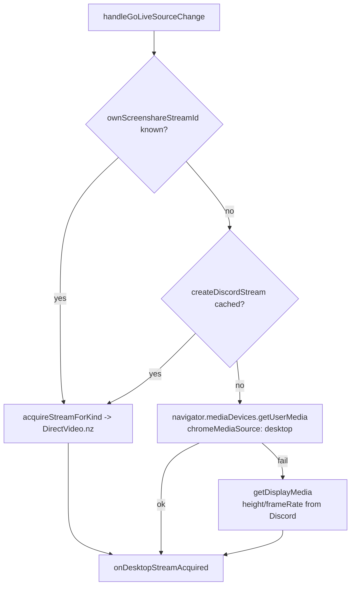
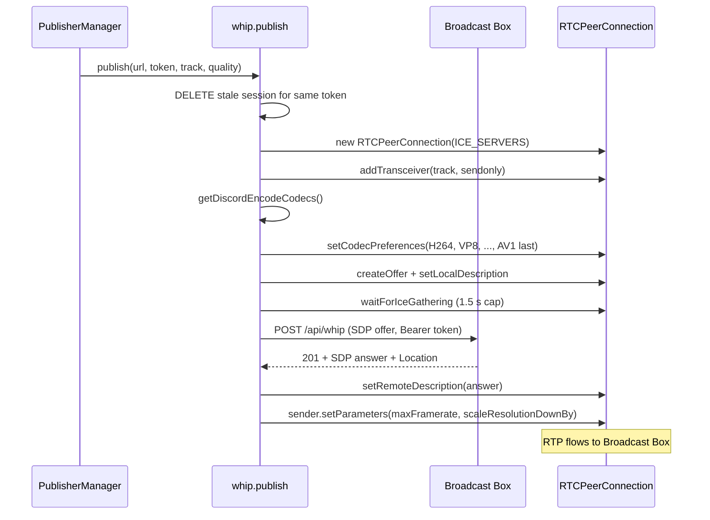

# Plugin Flow

This document describes the runtime behavior from plugin start to teardown.

## 1. Startup

`definePlugin` calls `start()` once when the plugin is enabled.



Installed hooks:

| Hook | Why |
| --- | --- |
| `window.createDiscordStream` | Capture native streams Discord creates and cache them by stream ID. |
| `HTMLMediaElement.prototype.srcObject` | Observe/discard Discord assigning its own stream to video elements when a hook owns them. |
| `MediaEngineActions.setGoLiveSource` | Detect screen share start/stop and read the requested quality. |
| `MediaEngineActions.setVideoEnabled` | Detect camera on/off. |
| `navigator.mediaDevices.getUserMedia` | Fallback capture path, clone the track and publish it. |
| `navigator.mediaDevices.getDisplayMedia` | Fallback capture path for Vesktop/Web. |
| `FluxDispatcher` | Suppress stream timeout actions, react to stream/voice lifecycle events. |

## 2. Publishing a screen share

### 2.1 Trigger

Discord calls `MediaEngineActions.setGoLiveSource(sourceConfig)` when the user
clicks **Go Live**.

1. The hook stores `requestedScreenQuality = qualityFromGoLiveSource(sourceConfig)`.
2. It calls the original function so Discord's own Go Live still starts.
3. It calls `handleGoLiveSourceChange(sourceConfig)`.

`sourceConfig` is typically:

```ts
{
    quality: { resolution: 1080, frameRate: 60 },
    desktopSource: { id: "screen:0:0", ... }
}
```

The legacy `qualityOptions: { resolution, fps }` shape is also accepted.

### 2.2 Track acquisition priority



`onDesktopStreamAcquired` rejects the track when:

- it has no video track,
- it is the current camera track (Discord may reuse the same source),
- it belongs to a different stream ID than the user's own screen share,
- the publisher is already running this exact track.

### 2.3 Quality resolution

`requestedScreenQuality` is merged with the track's real settings:

```text
target.height   = Discord Go Live height   ?? capture height
target.frameRate = Discord Go Live fps     ?? capture fps
```

If Discord chooses 720p60 but the capture is 1080p30, the target is 720p30: the
sender downscales to 720p and caps at 30 fps because the source cannot produce
60. Conversely, a 4K60 source with a 1080p60 request is downscaled to 1080p60.

### 2.4 WHIP publish



Session arbitration in `PublisherManager.start`:

- If the same stream/track is already current, do nothing.
- If a session is connected and only the track changed, `replaceTrack` and update
  sender quality (no renegotiation).
- If a session is pending, abort it.
- If a session is active for the same kind, stop it before starting a new one.
- The token is always `<currentUserId>-scrn` or `<currentUserId>-cam`.

### 2.5 Codec policy

Discord's native stream encoder defaults to H264 and falls back to VP8. The
plugin mirrors that:

1. Ask Discord's media engine for encodable codecs (500 ms timeout).
2. If available, drop codecs Discord cannot encode.
3. Sort remaining codecs as `H264 → VP8 → VP9 → AV1 → H265/HEVC → utility`.
4. Keep each RTX codec immediately after its base codec.
5. If the native bridge returns nothing, use the same static priority list.

This is why AV1 is no longer first. AV1 remains only as a last-resort fallback.

### 2.6 Sender quality

`applySenderQuality` changes only the WHIP sender:

- `encodings[0].maxFramerate = min(requested fps, capture fps)`
- `encodings[0].scaleResolutionDownBy = capture height / requested height`
  when the capture is larger than requested.

Discord's original `MediaStreamTrack` is never constrained, so the native Go Live
stream keeps its own quality.

## 3. Publishing the camera

`MediaEngineActions.setVideoEnabled(true)` triggers `handleCameraToggle(true)`.

1. Prefer `DirectVideo.nz(ownCameraStreamId)`.
2. Fall back to `getUserMedia({ video: { deviceId } })`.
3. Publish with `qualityFromTrack(track)` (the camera's native settings).
4. Token is `<userId>-cam`.

Toggling off stops the cam publisher and releases the direct video handle.

## 4. Viewing a remote stream

### 4.1 Discovery

`StreamWatcher` runs a debounced `MutationObserver` plus a periodic scan over
every document (main window and popouts). For each `<video>` element it:

1. Resolves the Discord user ID from the tile, React fiber props or ancestors.
2. Resolves the stream kind:
   - a live badge on the tile → `scrn`,
   - a focused/theater container while the user is streaming → `scrn`,
   - React props with `participant.type === "STREAM"` → `scrn`,
   - camera icon/voice state/fiber `selfVideo` → `cam`,
   - fallback: `scrn` if the user is streaming, otherwise `cam`.
3. Skips the current user's own tiles (the publisher already shows the feed).

```mermaid
flowchart TD
    M[MutationObserver / interval] --> D[getAllDocuments]
    D --> Q[querySelectorAll video]
    Q --> R{qualifyVideo}
    R -->|no userId| X[skip]
    R -->|self| X
    R --> K[resolveStreamKind]
    K --> S[WhepSubscriptionManager.getOrCreate]
    S --> H[new VideoHook(video, subscription)]
    H --> L[track in attachedElements]
```

### 4.2 Subscription

`WhepSubscriptionManager.getOrCreate(userId, kind, baseUrl)`:

- Returns the existing alive subscription for `<userId>-<kind>`.
- Otherwise closes any dead entry and creates/starts a new `WhepSubscription`.

`WhepSubscription.start()` → `connect()`:

1. Increment `connectionGen`.
2. Abort any previous connection.
3. `subscribe()` to `POST /api/whep` with Bearer `<userId>-<kind>`.
4. On the first video track, store the `MediaStream`, mark `connected` and notify
   all attached elements.
5. On `track.ended`, `connectionState === failed/closed`, or fetch error,
   schedule a 3 s retry with a new generation.

### 4.3 DOM binding

`VideoHook`:

- Applies `autoplay`, `playsinline`, `muted`, `object-fit: contain`.
- Sets `srcObject` through the native descriptor.
- Redefines the element's own `srcObject` property so Discord cannot overwrite
  it (the setter is a no-op, the getter returns the WHEP stream).
- Calls `play()` and hides Discord loading/placeholder elements once frames are
  rendered.
- `destroy()` restores the native descriptor, removes the stream and un-hides
  placeholders. It does **not** close the shared subscription.

## 5. UI interception and the PiP limitation

The current implementation locks `srcObject` on the `<video>` element found by
`StreamWatcher`. This works for the main/fullscreen/theater tile because the same
element that Discord paints into is the one the hook owns.

Picture-in-picture is different:

- The PiP surface is a separate video element or a browser/PiP renderer that is
  created outside the normal tile tree.
- `StreamWatcher` may not discover it, or Discord may re-create it after the
  hook attaches.
- When it is discovered late, the hook may attach after Discord has already
  painted a black frame or the element may be replaced on the next render.

The planned fix (deferred until the user approves the initial compile) is to
extend discovery to PiP containers, re-attach on DOM replacement, and force a
repaint after `loadedmetadata`/`playing`. See
[decisions.md](./decisions.md#open-questions).

## 6. Teardown

`stop()` (plugin disabled or client unload):

1. Remove `beforeunload`.
2. Restore every patched function/descriptor.
3. Treat screen share and camera as stopped.
4. Stop all publishers (`DELETE` each WHIP session).
5. Release direct-video handles.
6. Close all WHEP subscriptions.
7. Stop the `StreamWatcher` observer and interval.

`beforeunload` performs the same media teardown without uninstalling hooks.

## 7. Dispatcher behavior

| Action/event | Reaction |
| --- | --- |
| `MEDIA_ENGINE_SET_GO_LIVE_SOURCE` | Start/stop the screen publisher from the same payload Discord uses. |
| `MEDIA_ENGINE_SET_VIDEO_ENABLED` | Start/stop the camera publisher. |
| `RTC_CONNECTION_VIDEO` | Track the current user's native stream ID; `streamId === null` stops the matching publisher. |
| `STREAM_DELETE` | Close the remote subscription; if it is the current user's stream, stop publishing. |
| `VOICE_STATE_UPDATES` | Close subscriptions for users who left the channel or turned their camera off. |
| `VOICE_CHANNEL_SELECT` (null) | Tear down every publisher and subscription. |
| `VIDEO_STREAM_READY_TIMEOUT` / `VIDEO_STREAM_TIMEOUT` | Suppressed so Discord does not show its "stream failed" UI while WHEP is the real source. |